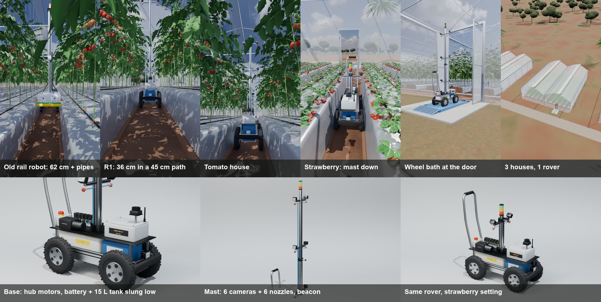

# R1: a scout + spot-spray rover for soil-bed polyhouses

Most greenhouse robots ride on the heating pipes of Dutch-style glasshouses. Indian polyhouses have no pipes: crops grow in
raised soil beds under mulch, with 40–60 cm paths between them, margins are low and farm labour costs about ₹550 a day.
R1 is designed for that: a 36 cm wide rover that drives in the path, photographs every plant, predicts disease risk, and
sprays only the plants a human approves. One rover serves several houses and crops.

## The rover (real parts, real sizes)

Modelled part by part in Blender ([`blender/components/rover.py`](../blender/components/rover.py)); prices are estimates
from Indian listings (Oct 2026), so check each one before buying.

| Part | What it does | ≈ ₹ |
|---|---|---|
| 4 × 10" 24 V 350 W brushless hub motor, pneumatic tyre | grip on soft soil, no gearbox to clog | 4 × 6,300 |
| 4 × ZS-X11H BLDC driver | one per wheel; skid steer, turns on the spot | 4 × 1,200 |
| 24 V 30 Ah LiFePO4 + BMS | ~5 h, slung low so the mast can't tip it | 18–25k |
| Raspberry Pi 5 8 GB + AI HAT+ (26 TOPS) | route, cameras, on-board AI that works offline | 9k + 15k |
| 7 × Camera Module 3 (+ 2 Arducam 4-channel adapters) | 6 on the mast (3 heights × 2 sides), 1 front | 7 × 3,158 |
| Slamtec RPLIDAR C1 | sees both bed walls, keeps it centred | 7–8k |
| 24 V diaphragm sprayer pump, 6 solenoid valves, 6 TeeJet ConeJet tips, 15 L tank | one valve per nozzle: sprays one side, one height | ~12k |
| 2040 / 4040 aluminium extrusion, IP65 box, e-stop, LED beacon, bumpers, 4G router | frame and safety | ~20k |
| **Total** | | **≈ ₹1.5 lakh** |

- **Body:** 36 cm wide, 70 cm long. Battery and tank sit between the wheels, 10 cm off the ground.
- **Mast:** telescopic, set once per crop: 1.95 m for tomato, 0.68 m for strawberry.
- **Cameras:** a white LED flash ring on each, so photos look the same at 9 AM and 4 PM. The lowest pair tilts 25° up to see leaf undersides, where whitefly and mites hide.

## Software: semi-automatic

| Step | What happens | Who decides |
|---|---|---|
| **1 Capture** | Every 25 cm: 6 photos, each stamped with house · bed · metre · side · height (a tag at every bed end + wheel counting; GPS doesn't work well inside). A climate box per house logs temperature, humidity and leaf wetness every 5 min. | automatic |
| **2 Analyse** | On the rover, offline: a small model flags "something's wrong". Only the odd 1–2 % go online for a second opinion (disease services such as Plantix are ~74 % right on real field photos). Each plant is compared with its own photo from last week. | automatic |
| **3 Predict** | Hours of high humidity at disease-friendly temperatures give each house a green / amber / red risk every morning, before spots appear. | automatic |
| **4 Message** | The farmer gets the photo, the exact plant and how sure the AI is. **Spray · Not disease · I'll check.** Every tap teaches the model this farm. | **farmer** |
| **5 Spray** | One valve opens at that plant. The valves stay locked unless: the farmer said yes · the product is approved for that crop · nobody is in the house · the product's waiting period ends before the next picking. Amber light while spraying. | farmer approves, locks are automatic |

Mixing the tank and moving the rover between houses (driven from a phone) also stay human.

## The part people miss: the rover can carry disease

A machine that visits every plant in every house can spread what it touches:

- **Tyres:** soil fungi, bacteria, nematodes.
- **Arms and cameras that brush leaves:** spores, contact viruses such as ToBRFV.
- **Insects** that ride along.
- **Tank residue** between crops.

USDA's ToBRFV guidance says to disinfect equipment between greenhouses and to use mats for wheeled equipment. A Humboldt University Berlin study found tyres and casters were the weak point in hygiene plans.

R1's rules:
- Visit healthy houses first and the sick one last, and never go back into a clean house the same day.
- Every door has a wheel bath and a 4-second disinfectant mist arch ([`mist_arch`](../blender/components/rover.py)), used on the way in and out.
- Short arms that stay in the middle of the path.
- Rinse the tank between crops.
- A trip log, so you can trace where a disease travelled.

Done right, the rover cuts spread: fewer people walk every row every day.

## Build it in steps (cheapest first)

1. **Eyes on a trolley (₹15–25k):** the camera mast on a hand-pushed trolley, a climate box per house, phone alerts.
2. **Add wheels:** it drives the rows itself; a worker moves it between houses.
3. **Add the sprayer:** spot spraying with phone approval and the locks.

Each step only goes ahead if the one before it proves its value on a real farm.

## Sources

- Plantix API toolkit (field vs test accuracy): https://plantix.net/en/plantix-intelligence/api-toolkit/
- MARTS spot-spraying robot, 71 % less pesticide: https://arxiv.org/abs/2610.18123
- USDA ToBRFV prevention: https://www.aphis.usda.gov/import_export/plants/plant_imports/tobrfv/tobrfv-strategies-for-prevention.pdf
- Integrated hygiene / tyre decontamination: https://www.hortidaily.com/article/9831747/integrated-hygiene-for-greenhouse-biosecurity/
- Karnataka minimum wage for farm work (₹549.97/day, Apr 2026): https://wageindicator.org/en-in/work-in-india/minimum-wage31024-karnataka/31025-agriculture-and-related-works
- Bed and path sizes: https://www.bighaat.com/kisan-vedika/blogs/best-practices-for-polyhouse-vegetable-farming
- Rover Robotics MAX (60 cm wide, for comparison): https://roverrobotics.com/products/max-copy-1

## Files

- [`blender/components/rover.py`](../blender/components/rover.py): rover, strawberry setting, wheel bath, mist arch.
- [`blender/components/soilhouse.py`](../blender/components/soilhouse.py): soil-bed polyhouse, raised beds, silver mulch, drip, strawberry plant.
- [`blender/render_rover.py`](../blender/render_rover.py): studio renders. Run with Blender 5.2: `blender -b --factory-startup -P blender/render_rover.py`.
