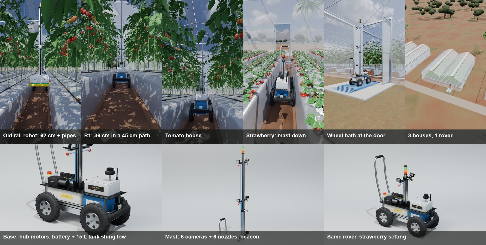

# R1: a scout + spot-spray rover for soil-bed polyhouses

Most greenhouse robots ride on the heating pipes of Dutch-style glasshouses. Indian polyhouses have no pipes: crops grow in
raised soil beds under mulch, with 40–60 cm paths between them, margins are low and farm labour costs about ₹550 a day.
R1 is designed for that: a 36 cm wide rover that drives in the path, photographs the plants (and lists what it could
not see), predicts disease risk from the climate, and sprays only the plants a human approves. One rover serves several
houses and crops. **It is a concept: designed, simulated and laptop-tested, not built.**

**Build it yourself:** [build/02-r1-rover](../build/02-r1-rover/): the full parts list with prices, every wire, and starter code.
**The three problems we hadn't solved** (an AI that doesn't know your farm, weak 4G inside, too many alerts): [SOLUTIONS.md](SOLUTIONS.md).
**Everything else that would stop it working** (obstacles, mud, changing houses, plants growing in, hidden leaves, heat,
cost, and 14 faults found in our own code), each with its fix and test: [build/02-r1-rover/ISSUES.md](../build/02-r1-rover/ISSUES.md).
The 3D model and the renders still show the first design (lidar up high, landscape cameras).

## The rover (real parts, real sizes)

Modelled part by part in Blender ([`blender/components/rover.py`](../blender/components/rover.py)); prices are estimates
from Indian listings (Nov 2026), so check each one before buying.

| Part | What it does | ≈ ₹ |
|---|---|---|
| 4 × 10" 24 V 350 W brushless hub motor, pneumatic tyre | grip on soft soil, no gearbox to clog | 4 × 6,300 |
| 4 × ZS-X11H BLDC driver | one per wheel; skid steer, turns on the spot | 4 × 1,200 |
| 24 V 30 Ah LiFePO4 + BMS | ~5 h, slung low so the mast can't tip it | 15–25k |
| Raspberry Pi 5 8 GB + AI HAT+ (26 TOPS) | route, cameras, on-board AI that works offline | 24k + 11k |
| 7 × USB camera (Arducam 12 MP IMX708 USB-C) + powered USB 3.0 hub | 6 on the mast (3 heights × 2 sides), 1 front; plug and play | 7 × 9,200 |
| Slamtec RPLIDAR C1, mounted low under the bed tops, + 2 ToF step sensors + a ground-speed sensor | sees the bed walls, low hoses and pipes, and mud | 9–15k |
| 24 V diaphragm sprayer pump, 6 solenoid valves, 6 TeeJet ConeJet tips, 15 L tank | one valve per nozzle: sprays one side, one height | ~12k |
| 2040 / 4040 aluminium extrusion, IP65 box + sun shield, e-stop with a RESET latch, LED beacon, bumpers | frame and safety | ~20k |
| **Total** (one list: [bom.csv](../build/02-r1-rover/r1/calc/bom.csv)) | | **₹2.00–2.18 lakh** |

Cheaper ways to build it, and why none of them pays back on labour alone yet:
[build/02-r1-rover](../build/02-r1-rover/#three-ways-to-build-it).

Prices checked on 4 Nov 2026: Pi 5 8 GB ₹21,999 ([Robocraze](https://robocraze.com/products/raspberry-pi-5-8gb)) with cooler and card, AI HAT+ ₹11,309 ([Robocraze](https://robocraze.com/products/official-raspberry-pi-ai-hat-26-tops)),
USB camera ₹9,238 ([Amazon.in](https://www.amazon.in/Arducam-IMX708-Fixed-Focus-Camera-Module/dp/B0CJF1NYNP)), lidar ₹6,099–9,800 ([Tannatech](https://tannatechbiz.com/rplidar-c1-360-degree-laser-scanner.html), [ThinkRobotics](https://thinkrobotics.com/products/slamtec-rplidar-c1-laser-ranging-sensor)). Every line, with sources: [build/02-r1-rover](../build/02-r1-rover/#parts-indian-prices-nov-2026-estimates-check-before-buying).

- **Body:** 36 cm wide, 70 cm long. Battery and tank sit between the wheels, 10 cm off the ground.
- **Mast:** telescopic, set once per crop: 1.95 m for tomato, 0.91 m for strawberry (cameras at 0.85 m, above the plants).
- **Cameras:** USB, not the Pi's camera ports: users report the 4-way camera adapter doesn't detect Camera Module 3 on a Pi 5, while the USB version of the same sensor just plugs in. They are turned to portrait, so each one covers more of the plant's height, and they take turns, one at a time. Each has a white LED ring that stays on for the whole path, with fixed exposure, so photos look the same at 9 AM and 4 PM. The lowest pair tilts 10° up, towards the leaf undersides where whitefly and mites hide.

## Software: semi-automatic

| Step | What happens | Who decides |
|---|---|---|
| **1 Capture** | Every 25 cm: 6 photos, each stamped with house · bed · metre · side · height (a tag at every bed end + wheel counting; GPS doesn't work well inside). A climate box per house logs temperature, humidity and leaf wetness every 5 min. | automatic |
| **2 Analyse** | On the rover, offline: a small model flags "something's wrong". Only the odd 1–2 % go online for a second opinion (disease services such as Plantix are ~74 % right on real field photos). Each plant is compared with its own photo from last week. | automatic |
| **3 Predict** | Hours of high humidity at disease-friendly temperatures give each house a green / amber / red risk every morning, before spots appear. | automatic |
| **4 Message** | The farmer gets the photo, the exact plant and how sure the AI is. **Spray · Not disease · I'll check.** Every tap teaches the model this farm. | **farmer** |
| **5 Spray** | One valve opens at that plant. The valves stay locked unless: the farmer said yes · the product is approved for that crop · nobody is in the house · the product's waiting period ends before the next picking. Amber light while spraying. | farmer approves, locks are automatic |

Mixing the tank and moving the rover between houses (driven from a phone) also stay human.

## The part people miss: the rover can carry disease

A machine that visits every plant in every house can spread what it touches:

- **Tyres:** soil fungi, bacteria, nematodes.
- **Arms and cameras that brush leaves:** spores, contact viruses such as ToBRFV.
- **Insects** that ride along.
- **Tank residue** between crops.

USDA's ToBRFV guidance says to disinfect equipment between greenhouses and to use mats for wheeled equipment. A Humboldt University Berlin study found tyres and casters were the weak point in hygiene plans.

R1's rules:
- Visit healthy houses first and the sick one last, and never go back into a clean house the same day.
- Every door has a wheel bath and a 4-second disinfectant mist arch ([`mist_arch`](../blender/components/rover.py)), used on the way in and out.
- Short arms that stay in the middle of the path.
- Rinse the tank between crops.
- A trip log, so you can trace where a disease travelled.

Done right, the rover cuts spread: fewer people walk every row every day.

## Build it in steps (cheapest first)

0. **A phone on a stick (almost free):** 4 weeks of photos on the worker's daily round, the grower's taps on each
   one, and his own record of what he found. This measures the one number that decides whether R1 is worth building:
   does an early warning save crop? (bench test B15 in [ISSUES.md](../build/02-r1-rover/ISSUES.md))
1. **Eyes on a trolley (about ₹0.6 lakh at Nov 2026 prices; the ₹15–25k first estimate used Oct prices):** the camera
   mast on a hand-pushed trolley, a climate box per house, phone alerts. 87 % of it carries over into step 2.
2. **Add wheels:** it drives the rows itself; a worker moves it between houses.
3. **Add the sprayer:** spot spraying with phone approval and the locks.

Each step only goes ahead if the one before it proves its value on a real farm.

## Sources

- Plantix API toolkit (field vs test accuracy): https://plantix.net/en/plantix-intelligence/api-toolkit/
- MARTS spot-spraying robot, 71 % less pesticide: https://arxiv.org/abs/2610.18123
- USDA ToBRFV prevention: https://www.aphis.usda.gov/import_export/plants/plant_imports/tobrfv/tobrfv-strategies-for-prevention.pdf
- Integrated hygiene / tyre decontamination: https://www.hortidaily.com/article/9831747/integrated-hygiene-for-greenhouse-biosecurity/
- Karnataka minimum wage for farm work (₹549.97/day, Apr 2026): https://wageindicator.org/en-in/work-in-india/minimum-wage31024-karnataka/31025-agriculture-and-related-works
- Bed and path sizes: https://www.bighaat.com/kisan-vedika/blogs/best-practices-for-polyhouse-vegetable-farming
- Rover Robotics MAX (60 cm wide, for comparison): https://roverrobotics.com/products/max-copy-1

## Files

- [`blender/components/rover.py`](../blender/components/rover.py): rover, strawberry setting, wheel bath, mist arch.
- [`blender/components/soilhouse.py`](../blender/components/soilhouse.py): soil-bed polyhouse, raised beds, silver mulch, drip, strawberry plant.
- [`blender/render_rover.py`](../blender/render_rover.py): studio renders. Run with Blender 5.2: `blender -b --factory-startup -P blender/render_rover.py`.
